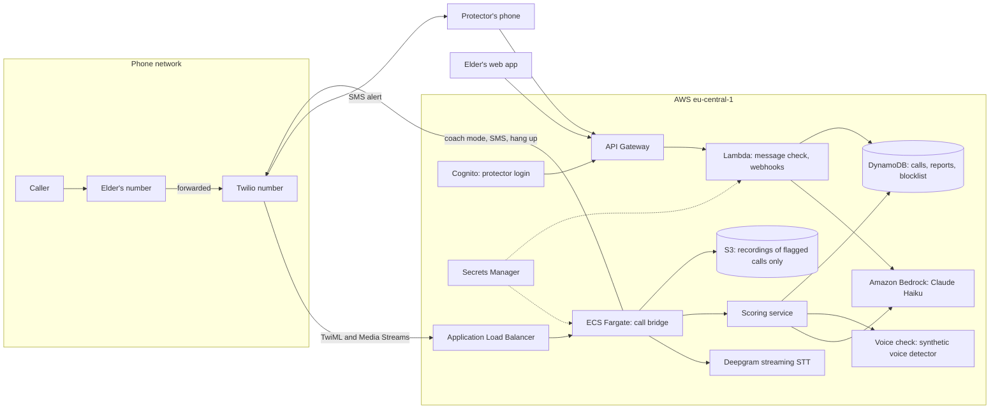

# Production architecture on AWS

This is the design Ellie would run on in production. The MVP in this repo is deliberately a single Python server plus static files, because a working demo in one day beats a half-built cloud. Everything below is a target, not a claim about what runs today.

All services sit in **eu-central-1 (Frankfurt)**. Call audio and transcripts never leave the EU, which is the first question any German bank, carrier or care provider will ask.

## Why each piece

| Need | Service | Why this and not something else |
|---|---|---|
| Hold a WebSocket open for the whole call | ECS Fargate behind an ALB | Lambda cannot keep long connections open. Fargate runs the Node bridge with no servers to patch. |
| Score a pasted SMS, WhatsApp or email | API Gateway plus Lambda | Short, stateless requests. Scales to zero between calls. |
| Claude | Amazon Bedrock | Same Claude models, inside the AWS account and region. No audio-derived text leaves AWS. [NEEDS CONFIRMATION: Haiku and Sonnet availability in eu-central-1 on the day of build] |
| Live transcript | Deepgram streaming | About 300 ms lag, speaker tracks separated. Swap for Amazon Transcribe streaming if the client requires all-AWS. |
| Synthetic voice check | Pindrop (external) or an in-house model on SageMaker later | Phone audio is narrow-band; Pindrop is built for it. Output is one more scoring input, never a verdict on its own. [NEEDS CONFIRMATION: API access and EU pricing] |
| Flagged calls, reports, blocklist, protector links | DynamoDB | Key-value access patterns, point-in-time recovery, encryption at rest by default. |
| Recordings | S3 with KMS encryption, lifecycle rule deletes after 30 days | Only calls that cross 80 are stored. Everything else is discarded when the call ends. |
| Protector accounts | Cognito | Managed login, MFA, no passwords in our database. |
| API keys (Twilio, Deepgram, Pindrop) | Secrets Manager | Never in code or environment files. |
| Observability | CloudWatch logs and alarms | Alarm on scoring latency over 3 s and on Twilio webhook errors. |

## Compliance notes

- **Recording notice:** Ellie announces at call start that the call is protected and may be recorded. This is the notice required before recording a call in Germany, and it doubles as a deterrent. [NEEDS CONFIRMATION with a lawyer: exact wording under § 201 StGB and whether notice is enough when the other party is a suspected offender]
- **Data minimisation (GDPR Art. 5):** transcript lives in memory during the call. Below 80, nothing is kept except number, time and score. At 80 and above, transcript and recording are kept for the report.
- **Retention:** 30 days by default, extended only when the user or protector files a police report.
- **Consent:** the elder (or their legal representative) opts in when setting up call forwarding. Protectors see alerts, not full recordings, unless the elder shares them.
- **Encryption:** TLS in transit everywhere; KMS at rest for S3 and DynamoDB.
- **Right to erasure:** one DynamoDB key per user; deleting it removes reports and triggers an S3 purge.

## Cost shape

Roughly a few cents per protected call minute: Twilio inbound, the outbound leg to the elder's phone, and STT. Claude Haiku checks every 10 to 15 s add a fraction of a cent per minute. Fargate and the rest are a fixed base cost. [NEEDS DATA: current Twilio DE and Deepgram pricing]

## Path from the MVP to this

1. Keep `backend/scoring/score.py` and `prompts/scam-scorer.md` as the contract. Port them into the Node bridge unchanged.
2. Deploy the bridge to Fargate; point a Twilio number at it.
3. Move the `/api/check` endpoint from `backend/server.py` to Lambda.
4. Switch the Anthropic SDK call to Bedrock.
5. Add the voice check as a scoring input once the vendor contract is in place.
